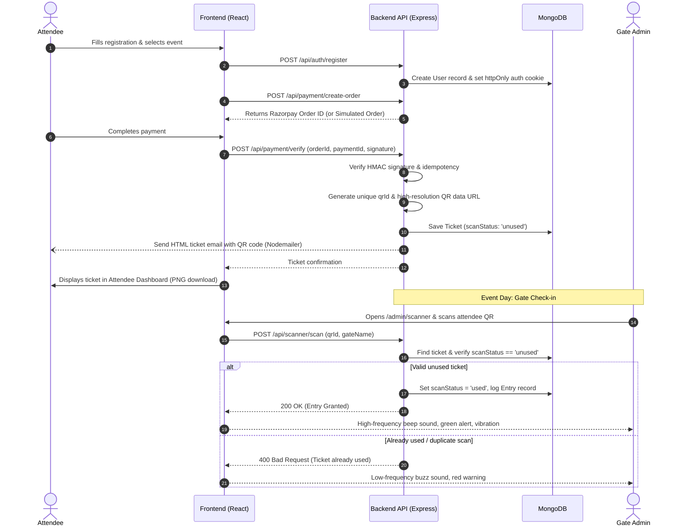

# QR-Based Ticketing System (MERN Stack)

A full-stack event ticketing and access control platform built on the **MERN** stack (MongoDB, Express, React, Node.js). The system features dynamic cryptographic QR code ticket generation, Razorpay checkout with a simulated test mode fallback, role-based access control (Attendee, Gate Staff Admin, Super Admin), live in-browser camera QR code scanning with audio feedback and offline synchronization, and real-time event analytics.

---

## 📑 Table of Contents

- [Features](#-features)
  - [Attendee Experience](#attendee-experience)
  - [Gate Staff Operations (Admin)](#gate-staff-operations-admin)
  - [Super Administrator Console](#super-administrator-console)
  - [Security & Architecture](#security--architecture)
- [Technologies Used](#-technologies-used)
- [Project Structure](#-project-structure)
- [How the QR Ticket Flow Works](#-how-the-qr-ticket-flow-works)
- [Prerequisites](#-prerequisites)
- [Installation & Setup](#-installation--setup)
  - [1. Clone Repository](#1-clone-repository)
  - [2. Server Setup](#2-server-setup)
  - [3. Database Seeding & Admin Provisioning](#3-database-seeding--admin-provisioning)
  - [4. Client Setup](#4-client-setup)
- [Environment Variables](#-environment-variables)
- [Razorpay Test Mode Setup & Testing](#-razorpay-test-mode-setup--testing)
- [Running the Application](#-running-the-application)
- [API Reference](#-api-reference)
  - [Authentication (`/api/auth`)](#authentication-apiauth)
  - [Events (`/api/events`)](#events-apievents)
  - [Payments (`/api/payment`)](#payments-apipayment)
  - [Attendee Tickets (`/api/tickets`)](#attendee-tickets-apitickets)
  - [Scanner & Check-in (`/api/scanner`)](#scanner--check-in-apiscanner)
  - [Admin Operations (`/api/admin`)](#admin-operations-apiadmin)
  - [Super Admin Operations (`/api/superadmin`)](#super-admin-operations-apisuperadmin)
- [Deployment Notes](#-deployment-notes)

---

## 🚀 Features

### Attendee Experience
- **Event Discovery:** Browse available active events with real-time pricing, date, and venue details (`/`).
- **Validated Registration:** Multi-step attendee signup with field sanitization, phone validation, age checks (minimum 10 years), and password complexity enforcement (`/register`).
- **Payment Integration:** Razorpay checkout order creation and server-side HMAC SHA256 signature verification. Includes a built-in simulated test payment flow if live Razorpay keys are omitted.
- **Cryptographic QR Passes:** Automated issuance of unique 16-byte random hex cryptographic identifiers (`qrId`) embedded into high-resolution QR codes (`qrcode`).
- **Email Delivery:** Automated ticket dispatch containing embedded HTML pass design via Nodemailer (gracefully falls back to console mock if SMTP credentials are not configured).
- **Attendee Passbook:** Dedicated portal (`/dashboard`) to view active tickets, open full-screen ticket inspection modals, and download tickets as PNG files.

### Gate Staff Operations (Admin)
- **Role-Based Gate Login:** Dedicated authentication portal for ground staff (`/admin`).
- **Live Event Dashboard:** Real-time metrics tracking total registrations, tickets sold, validated check-ins, remaining capacity, and a live stream of recent entries (`/admin/dashboard`).
- **Camera-Based QR Scanner:** Integrated video camera scanning powered by `html5-qrcode` with device selection and manual ticket code input fallback (`/admin/scanner`).
- **Synthesized Audio & Haptic Feedback:** Web Audio API oscillator synthesizer delivering instant high-pitched double-beeps on successful check-in and low warning buzzes on rejection, paired with mobile vibration.
- **Offline Check-in Queue:** Automatic fallback to client-side `localStorage` queuing during network disconnection, with one-click batch reconciliation (`POST /api/scanner/sync`) upon reconnection.
- **Duplicate-Scan Prevention:** Atomic status transition (`unused` to `used`) preventing re-entry, with immediate alert warnings for rapid duplicate scan attempts.
- **Attendee Roster & QR Reset:** Searchable attendee list with check-in timestamps, gate identification, and emergency pass reset functionality with audit logging (`/admin/registrations`).

### Super Administrator Console
- **Platform Analytics:** Cross-event operational summaries including total tickets, gross revenue, check-in conversion rates, and hourly gate traffic distribution (`/super-admin/dashboard`).
- **Event Management:** Full lifecycle controls to create and delete events with date ranges, capacity limits, and pricing.
- **Staff Admin Provisioning:** Create and delete gate staff accounts, assign staff to specific events, and manage access privileges.

### Security & Architecture
- **Cookie-Based Sessions:** `httpOnly`, `sameSite` JWT tokens ensuring tokens are inaccessible to browser JavaScript (protecting against XSS).
- **In-Memory Rate Limiting:** Brute-force protection on all authentication routes (5 attempts per 15 minutes for users and admins; 3 attempts for super admins).
- **Password Hashing:** Passwords hashed with `bcryptjs` using a cost factor of 12.
- **Idempotent Payment Processing:** Enforces single-ticket-per-payment constraints to prevent duplicate passes on network retries.
- **Interactive CLI Admin Tool:** Non-destructive account creation script with masked terminal password entry.
- **Dark & Light Mode:** Theme switcher with persistent theme state.

---

## 🛠 Technologies Used

### Backend
- **Runtime:** [Node.js](https://nodejs.org/) (v18+)
- **Framework:** [Express.js](https://expressjs.com/) (v4.x)
- **Database & ODM:** [MongoDB](https://www.mongodb.com/) via [Mongoose](https://mongoosejs.com/) (v8.x)
- **Authentication & Security:** [jsonwebtoken](https://github.com/auth0/node-jsonwebtoken) (JWT), [bcryptjs](https://github.com/dcodeIO/bcrypt.js)
- **QR Generation:** [qrcode](https://github.com/soldair/node-qrcode)
- **Payments:** [Razorpay Node SDK](https://razorpay.com/docs/payments/server-integration/nodejs/) & Node.js `crypto`
- **Email Service:** [Nodemailer](https://nodemailer.com/)

### Frontend
- **Framework:** [React 18](https://react.dev/)
- **Build Tool:** [Vite 5](https://vitejs.dev/)
- **Routing:** [React Router v7](https://reactrouter.com/)
- **Styling:** [Tailwind CSS](https://tailwindcss.com/) & PostCSS
- **Animations:** [Framer Motion](https://www.framer.com/motion/)
- **QR Decoding:** [html5-qrcode](https://github.com/mebjas/html5-qrcode)
- **Icons:** [Lucide React](https://lucide.dev/)
- **Audio:** Native Browser Web Audio API

---

## 📂 Project Structure

```text
qr-ticketing-mern/
├── client/                      # React + Vite frontend application
│   ├── index.html               # Frontend HTML entry point
│   ├── package.json             # Frontend dependencies & scripts
│   ├── tailwind.config.js       # Tailwind CSS configuration
│   ├── vite.config.js           # Vite config with /api proxy to localhost:5000
│   └── src/
│       ├── App.jsx              # Main router & theme/auth providers
│       ├── main.jsx             # React DOM root render
│       ├── components/          # Reusable UI components
│       │   ├── Button.jsx       # Standard button with variants
│       │   ├── Modal.jsx        # Dialog modal component
│       │   ├── QRScanner.jsx    # Camera scanner & Web Audio synthesizer
│       │   ├── ThemeToggle.jsx  # Dark/Light mode switcher
│       │   └── Toast.jsx        # Notification popups
│       ├── context/             # React Context providers
│       │   ├── AuthContext.jsx  # Cookie-backed auth session state
│       │   └── ThemeContext.jsx # Dark/Light theme state
│       ├── pages/               # Application route views
│       │   ├── HomePage.jsx               # Landing page & event catalog
│       │   ├── RegisterPage.jsx           # Attendee signup & payment modal
│       │   ├── LoginPage.jsx              # Attendee login
│       │   ├── DashboardPage.jsx          # Attendee ticket passbook
│       │   ├── AdminLoginPage.jsx         # Gate staff login
│       │   ├── AdminDashboardPage.jsx     # Staff live event metrics
│       │   ├── AdminScannerPage.jsx       # Live QR camera scanner
│       │   ├── AdminRegistrationsPage.jsx # Attendee roster & pass resets
│       │   ├── SuperAdminLoginPage.jsx    # Super Admin login
│       │   └── SuperAdminDashboardPage.jsx# Global analytics & management
│       └── utils/
│           └── api.js           # Safe JSON fetch wrapper
│
├── server/                      # Node.js + Express backend application
│   ├── package.json             # Backend dependencies & npm scripts
│   ├── server.js                # Express app initialization & route mounting
│   ├── .env.example             # Example environment variables template
│   ├── config/
│   │   └── db.js                # MongoDB connection handler
│   ├── controllers/             # Business logic controllers
│   │   ├── adminController.js   # Gate stats, attendee lists, QR reset
│   │   ├── authController.js    # Register, login, me, logout, rate limiter
│   │   ├── paymentController.js # Razorpay order creation & verification
│   │   ├── scannerController.js # Real-time scan & offline sync handlers
│   │   ├── superAdminController.js # Analytics, event & staff admin CRUD
│   │   └── ticketController.js  # Attendee ticket queries
│   ├── models/                  # Mongoose data schemas
│   │   ├── ActivityLog.js       # Admin action audit trail
│   │   ├── Admin.js             # Staff admin credentials & event scopes
│   │   ├── Entry.js             # Gate check-in logs
│   │   ├── Event.js             # Event details, pricing & capacity
│   │   ├── OTP.js               # One-time verification tokens
│   │   ├── SuperAdmin.js        # Platform administrator account
│   │   ├── Ticket.js            # Ticket pass, QR ID, payment & scan status
│   │   └── User.js              # Attendee profile
│   ├── routes/                  # Express API route endpoints
│   │   ├── adminRoutes.js
│   │   ├── authRoutes.js
│   │   ├── eventRoutes.js
│   │   ├── paymentRoutes.js
│   │   ├── scannerRoutes.js
│   │   ├── superAdminRoutes.js
│   │   └── ticketRoutes.js
│   ├── scripts/                 # CLI database utilities
│   │   ├── create-admin.js      # Interactive masked admin creation tool
│   │   └── seed.js              # Database seed script for demo event
│   └── utils/                   # Server helpers
│       ├── auth.js              # JWT sign/verify & bcrypt helpers
│       ├── email.js             # Nodemailer HTML ticket dispatch
│       ├── qr.js                # QR code & QR ID generation
│       ├── razorpay.js          # Payment order & signature verification
│       └── validation.js        # Input validation & rate limiter
│
├── PROGRESS.md                  # Development progress log
└── README.md                    # Project documentation
```

---

## 🔄 How the QR Ticket Flow Works



### Flow Breakdown:
1. **Registration & Checkout:** The user registers at `/register`. Upon account creation, the client initiates payment with `/api/payment/create-order`.
2. **Signature Verification & Issuance:** After checkout, `/api/payment/verify` cryptographically verifies the Razorpay signature. A 16-byte random hex string (`qrId`) is generated and converted into an error-corrected QR code data URL. A `Ticket` record is stored with `scanStatus: 'unused'`.
3. **Delivery:** The ticket is non-blockingly dispatched via Nodemailer with an HTML pass layout, and made available for viewing and PNG download at `/dashboard`.
4. **Gate Scanning:** At the entrance, an admin scans the code via `/admin/scanner`.
   - **Online Mode:** The scanner issues `POST /api/scanner/scan`. If unused, `scanStatus` flips atomically to `used` and an `Entry` check-in log is written.
   - **Duplicate Detection:** If scanned again, the API returns a `400` status with previous scan details (gate and timestamp), playing an error buzz.
   - **Offline Mode:** If connectivity is lost, scans are saved to the browser's `localStorage`. When the network recovers, the admin submits them via `POST /api/scanner/sync`, which reconciles entries without overwriting earlier online check-ins.
5. **Pass Reset:** In exceptional circumstances, admins can reset an attendee's scan status to `unused` from `/admin/registrations`, logging the intervention to `ActivityLog`.

---

## 📋 Prerequisites

Before running the application locally, ensure you have the following installed:

- **Node.js**: `v18.x` or `v20.x` (LTS recommended)
- **npm**: `v9.x` or newer
- **MongoDB**: A running local MongoDB instance (`mongodb://localhost:27017`) or a free [MongoDB Atlas](https://www.mongodb.com/atlas) cluster connection string.
- **Web Browser**: A modern browser (Chrome, Firefox, Safari, Edge) with camera permissions enabled for QR code scanning.

---

## ⚙️ Installation & Setup

### 1. Clone Repository

```bash
git clone <repository_url>
cd qr-ticketing-mern
```

### 2. Server Setup

Navigate into the `server/` directory and install dependencies:

```bash
cd server
npm install
```

Create your `.env` configuration file from the template:

```bash
cp .env.example .env
```

Open `server/.env` and configure your local settings (see [Environment Variables](#-environment-variables) below).

### 3. Database Seeding & Admin Provisioning

While inside the `server/` directory:

1. **Seed the sample event** (creates demo event `TechCon 2026`):
   ```bash
   npm run seed
   ```

2. **Create administrative accounts interactively**:
   ```bash
   npm run create-admin
   ```
   Follow the interactive terminal prompts:
   - Select role: `1` for **Super Administrator** or `2` for **Gate Staff Admin**.
   - Enter your email address and display name.
   - Enter your secure password (input is masked with `*` and never stored in plaintext).

### 4. Client Setup

Open a new terminal window, navigate into the `client/` directory, and install dependencies:

```bash
cd ../client
npm install
```

> [!NOTE]
> The client uses Vite's built-in development proxy (`client/vite.config.js`) configured to route all `/api` requests to `http://localhost:5000`. No client `.env` file is required for local development.

---

## 🔐 Environment Variables

The backend relies on the environment variables defined below. Configure them inside `server/.env`.

> [!IMPORTANT]
> Never commit `.env` or production credentials to version control. The `.env` file is excluded in `.gitignore`.

| Variable Name | Required | Default / Placeholder | Description |
|---|---|---|---|
| `PORT` | Optional | `5000` | Port for the Express backend server |
| `MONGO_URI` | **Required** | `mongodb://localhost:27017/qr-ticketing` | MongoDB connection string (local or Atlas) |
| `JWT_SECRET` | **Required** | `your_jwt_secret_key_here` | 256-bit secret key used to sign and verify JWT session cookies |
| `CLIENT_URL` | Optional | `http://localhost:3000` | Frontend application URL permitted by CORS |
| `NODE_ENV` | Optional | `development` | Set to `production` in production to enforce `secure` cookies |
| `RAZORPAY_KEY_ID` | Optional | `your_razorpay_key_id` | Razorpay API Key ID. If omitted, the app runs in **simulated test mode** |
| `RAZORPAY_KEY_SECRET`| Optional | `your_razorpay_key_secret` | Razorpay API Key Secret used to verify payment webhook signatures |
| `EMAIL_HOST` | Optional | `smtp.example.com` | SMTP server host. If omitted, emails are logged to the console mock |
| `EMAIL_PORT` | Optional | `587` | SMTP port (e.g., 587 for TLS, 465 for SSL) |
| `EMAIL_USER` | Optional | `your_email@example.com` | SMTP username / sender email address |
| `EMAIL_PASSWORD` | Optional | `your_email_password` | SMTP password or app-specific password |

---

## 💳 Razorpay Test Mode Setup & Testing

The system supports both official **Razorpay Test Mode** (via Razorpay Checkout SDK and server-side HMAC verification) and a fallback **simulated test mode** (if API keys are omitted).

### 1. Obtaining Razorpay Test Mode Credentials
1. Log in to your [Razorpay Dashboard](https://dashboard.razorpay.com/).
2. Switch to **Test Mode** using the toggle switch in the dashboard header.
3. Navigate to **Account & Settings** $\rightarrow$ **API Keys** (under *Website and app settings*).
4. Click **Generate Test Key** (or use your existing test key).
5. Copy your **Key Id** (starts with `rzp_test_...`) and **Key Secret**.

### 2. Configuring Backend Environment
In `server/.env`, set your test credentials:

```env
RAZORPAY_KEY_ID=your_razorpay_test_key_id
RAZORPAY_KEY_SECRET=your_razorpay_test_key_secret
```

> [!CAUTION]
> - Never expose `RAZORPAY_KEY_SECRET` to the frontend or version control.
> - The client automatically retrieves only the public `RAZORPAY_KEY_ID` from `POST /api/payment/create-order`.
> - The backend determines the payment amount from trusted database event records; amounts sent from the browser are never trusted.

### 3. Step-by-Step Manual Test Mode Verification

1. **Start the backend and frontend:**
   ```bash
   # Terminal 1
   cd server && npm start

   # Terminal 2
   cd client && npm run dev
   ```
2. **Navigate to registration:** Open `http://localhost:3000/` and click on an active event (e.g. *TechCon 2026*), then click **Register**.
3. **Submit registration:** Complete the registration form with your name, email, phone, date of birth, and password. Click **Proceed to Pay**.
4. **Razorpay Checkout Modal:**
   - With keys configured, the official Razorpay Checkout popup will open with a **Test Mode** banner.
   - Click **Card** and use Razorpay's standard test card credentials:
     - **Card Number:** `4111 1111 1111 1111` (or any valid Visa test number)
     - **Expiry:** Any future date (e.g. `12/30`)
     - **CVV:** Any 3 digits (e.g. `123`)
     - **OTP:** Any 4 or 6 digits (e.g. `123456`)
   - Alternatively, test via **Netbanking** (select any test bank and click *Success*), or **UPI** (e.g. `success@razorpay`).
5. **Server Verification & Ticket Issuance:**
   - Upon successful payment in Checkout, Razorpay passes `razorpay_payment_id`, `razorpay_order_id`, and `razorpay_signature` to the frontend.
   - The frontend immediately sends these to `POST /api/payment/verify`.
   - The backend validates the HMAC SHA256 signature using `RAZORPAY_KEY_SECRET`.
   - Upon verification, the ticket status changes to `completed` and a cryptographic QR code (`qrCode` and `qrId`) is generated.
   - The user is redirected to `/dashboard` to view their verified pass.
6. **Testing Failure & Cancellation Handling:**
   - **User Dismissal / Cancellation:** Open the checkout modal and close it via the $(X)$ icon. The page displays a warning toast, records the cancellation (`POST /api/payment/cancel`), and keeps the "Pay with Razorpay" button active for immediate retry without losing registration.
   - **Declined Card Test:** In the Razorpay modal, select Netbanking $\rightarrow$ choose any bank $\rightarrow$ click *Failure*. The checkout will report the failure safely without exposing sensitive data, and allow retrying with another method.

---

## 💻 Running the Application

### 1. Start the Backend Server

From the `server/` directory:

```bash
cd server
npm start
```
The server will start on `http://localhost:5000`.

### 2. Start the Frontend Application

From the `client/` directory in a separate terminal:

```bash
cd client
npm run dev
```
The Vite development server will start on `http://localhost:3000`.

### 3. Application Access Points

| Portal | URL | Description |
|---|---|---|
| **Attendee Portal** | `http://localhost:3000/` | Browse events and start registration |
| **Attendee Passbook** | `http://localhost:3000/dashboard` | View confirmed tickets and download QR codes |
| **Gate Staff Login** | `http://localhost:3000/admin` | Login for gate check-in operators |
| **Live QR Scanner** | `http://localhost:3000/admin/scanner` | Camera scanner with audio & offline queue |
| **Super Admin Console** | `http://localhost:3000/super-admin` | Platform analytics, event & staff manager |

---

## 📡 API Reference

All backend endpoints are prefixed with `/api`. Unmatched routes return JSON `404` errors.

### Authentication (`/api/auth`)

| Method | Endpoint | Access | Description |
|---|---|---|---|
| `POST` | `/api/auth/register` | Public | Register an attendee account for an event |
| `POST` | `/api/auth/login` | Public | Authenticate attendee (sets `httpOnly` cookie) |
| `POST` | `/api/auth/admin/login` | Public | Authenticate gate staff administrator |
| `POST` | `/api/auth/superadmin/login` | Public | Authenticate master super administrator |
| `GET` | `/api/auth/me` | Authenticated | Retrieve current user session from JWT cookie |
| `POST` | `/api/auth/logout` | Authenticated | Clear session cookie and invalidate local state |

### Events (`/api/events`)

| Method | Endpoint | Access | Description |
|---|---|---|---|
| `GET` | `/api/events` | Public | List all active events |
| `GET` | `/api/events/:id` | Public | Retrieve details of an event by MongoDB ObjectId |

### Payments (`/api/payment`)

| Method | Endpoint | Access | Description |
|---|---|---|---|
| `POST` | `/api/payment/create-order` | Authenticated | Create a Razorpay order or simulated test order with server-calculated price |
| `POST` | `/api/payment/verify` | Authenticated | Verify HMAC signature, issue QR ticket, and trigger email |
| `POST` | `/api/payment/cancel` | Authenticated | Record cancelled or incomplete payment attempt |

### Attendee Tickets (`/api/tickets`)

| Method | Endpoint | Access | Description |
|---|---|---|---|
| `GET` | `/api/tickets` | Attendee | Fetch all tickets associated with the logged-in attendee |

### Scanner & Check-in (`/api/scanner`)

| Method | Endpoint | Access | Description |
|---|---|---|---|
| `POST` | `/api/scanner/scan` | Admin | Real-time scan validation with gate and status tracking |
| `POST` | `/api/scanner/sync` | Admin | Bulk synchronization of scans queued during offline operation |

### Admin Operations (`/api/admin`)

| Method | Endpoint | Access | Description |
|---|---|---|---|
| `GET` | `/api/admin/dashboard` | Admin | Retrieve check-in metrics and recent entries for an event |
| `GET` | `/api/admin/users` | Admin | Retrieve attendee roster with ticket scan states |
| `POST` | `/api/admin/users/:id/reset-qr` | Admin | Reset an attendee's ticket scan status to `unused` |
| `GET` | `/api/admin/activity-logs` | Admin | View administrative audit log of actions |

### Super Admin Operations (`/api/superadmin`)

| Method | Endpoint | Access | Description |
|---|---|---|---|
| `GET` | `/api/superadmin/analytics` | Super Admin | Cross-event ticket sales, revenue, and check-in rates |
| `GET` | `/api/superadmin/admins` | Super Admin | List all registered staff admin accounts |
| `POST` | `/api/superadmin/admins` | Super Admin | Create a new staff admin and assign to events |
| `DELETE` | `/api/superadmin/admins/:id` | Super Admin | Delete a staff admin account |
| `POST` | `/api/superadmin/events` | Super Admin | Create a new event |
| `DELETE` | `/api/superadmin/events/:id` | Super Admin | Delete an event |

---

## 🌐 Deployment Notes

- **Backend Deployment:** The Express application can be hosted on platforms such as Render, Railway, AWS EC2, or DigitalOcean.
  - Set `NODE_ENV=production`.
  - Configure `CLIENT_URL` with your production frontend domain to ensure CORS allows cookie transmission.
  - Ensure the host sets `secure: true` cookies (requires HTTPS).
- **Frontend Deployment:** The Vite client can be built for production using `npm run build` inside `client/`. The output directory `client/dist/` can be deployed on Vercel, Netlify, Cloudflare Pages, or an Nginx/S3 static host.
  - For client-side routing, configure your host to rewrite all non-file requests to `index.html`.
- **HTTPS Requirement:** Modern web browsers require a secure HTTPS context to grant camera access (`navigator.mediaDevices.getUserMedia`) for the QR scanner on mobile and remote devices (localhost is exempt).
- **Database:** Use MongoDB Atlas with network IP whitelisting matching your backend server's IP address.
